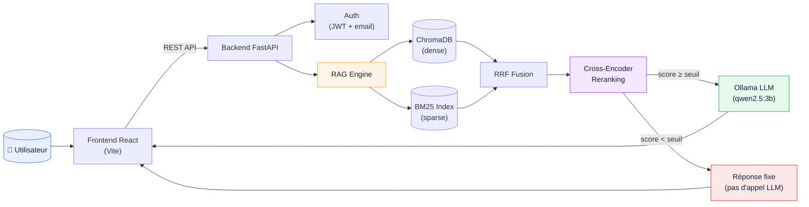
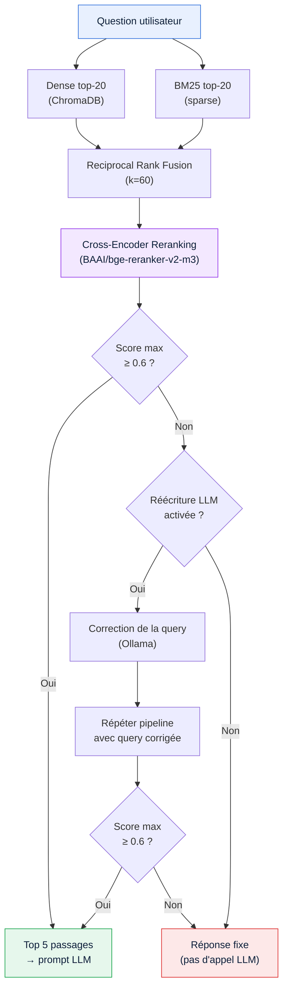

<div align="center">


**Chatbot intelligent pour les ressources humaines, propulsé par RAG et un pipeline de recherche hybride.**
Indexation · Dense + BM25 · Reciprocal Rank Fusion · Cross-Encoder Reranking · Ollama LLM


[Aperçu](#aperçu) · [Architecture](#architecture) · [Pipeline RAG](#pipeline-rag) · [Stack technique](#stack-technique) · [Installation](#installation) · [Utilisation](#utilisation) · [Structure du projet](#structure-du-projet)

</div>

---

## Aperçu

| Documents RH | Chunks indexés | Retrieval | Reranking | LLM |
|:---:|:---:|:---:|:---:|:---:|
| **17** (PDF, DOCX, TXT) | **104** | **Dense + BM25 hybride** | **Cross-Encoder** | **Ollama (local)** |

DocuRH est un chatbot RH interne qui permet aux employés de poser des questions en langage naturel sur les politiques de l'entreprise (congés, télétravail, règlement intérieur, notes de frais, etc.). Le système retrouve les passages pertinents dans la base documentaire et génère une réponse sourcée grâce à un LLM local.

> [!IMPORTANT]
> Le chatbot ne répond **jamais** à partir de ses propres connaissances. Si aucun document pertinent n'est trouvé (score de reranking sous le seuil), il retourne un message fixe sans appeler le LLM, ce qui évite les hallucinations.

## Architecture



## Pipeline RAG

Le cœur du système est un pipeline de recherche hybride en 7 étapes :

### Phase 1 – Indexation

| Étape | Description |
|---|---|
| Extraction | PDF (pdfplumber), DOCX (python-docx), TXT |
| Détection de structure | Headings markdown, tables simples |
| Chunking | `RecursiveCharacterTextSplitter` (500 tokens, 80 overlap) |
| Embeddings | `intfloat/multilingual-e5-base` (768d, multilingue) |
| Stockage dense | ChromaDB (persistant) |
| Stockage sparse | BM25Okapi (pickle sérialisé) |
| Fingerprinting | Évite la ré-indexation si les documents n'ont pas changé |

### Phase 2 – Recherche hybride + Reranking



### Paramètres configurables

Tous les hyperparamètres du pipeline vivent dans `backend/config.py` :

| Paramètre | Défaut | Rôle |
|---|:---:|---|
| `TOP_K_DENSE` | 20 | Nombre de candidats dense (Chroma) |
| `TOP_K_BM25` | 20 | Nombre de candidats sparse (BM25) |
| `RRF_K` | 60 | Constante k de la formule RRF |
| `RERANKER_MODEL` | `BAAI/bge-reranker-v2-m3` | Modèle cross-encoder |
| `RERANKER_TOP_N` | 5 | Passages conservés après reranking |
| `RERANKER_SCORE_THRESHOLD` | 0.6 | Seuil de pertinence minimum |
| `LLM_REWRITE_ENABLED` | `true` | Réécriture de la query en cas de score faible |

> [!TIP]
> Le seuil de reranking est un **levier métier** : l'abaisser retourne plus de réponses (au risque de moins de pertinence), le relever réduit les faux positifs.

## Stack technique

| Couche | Technologies |
|---|---|
| **Frontend** | React 18, Vite, React Router |
| **Backend** | FastAPI, SQLAlchemy, Uvicorn |
| **Auth** | JWT (python-jose), bcrypt, vérification email |
| **Embeddings** | `intfloat/multilingual-e5-base` (Sentence Transformers) |
| **Vector Store** | ChromaDB (persistant) |
| **Sparse Index** | BM25Okapi (rank_bm25) |
| **Reranker** | `BAAI/bge-reranker-v2-m3` (CrossEncoder) |
| **LLM** | Ollama (local, `qwen2.5:3b` par défaut) |
| **Documents** | pdfplumber, python-docx |

## Installation

### Prérequis

- **Python 3.11+**
- **Node.js 18+**
- **[Ollama](https://ollama.com/)** installé et en cours d'exécution

### 1. Cloner le dépôt

```bash
git clone https://github.com/SouMej/chatbot_RH.git
cd chatbot_RH
```

### 2. Backend

```bash
cd backend

# Créer et activer l'environnement virtuel
python -m venv venv
# Windows (PowerShell)
.\venv\Scripts\Activate.ps1
# macOS / Linux
source venv/bin/activate

# Installer les dépendances
pip install -r requirements.txt

# Configurer les variables d'environnement
cp .env.example .env
# Éditez .env avec votre clé secrète JWT

# Lancer le modèle Ollama
ollama pull qwen2.5:3b

# Indexer les documents RH
python indexation.py --docs_dir ./docs_test

# Lancer le serveur
uvicorn app.main:app --reload
```

### 3. Frontend

```bash
cd frontend
npm install
npm run dev
```

> [!NOTE]
> Le frontend sera accessible sur `http://localhost:5173` et le backend sur `http://localhost:8000`.

## Utilisation

1. **Créer un compte** via la page d'inscription (vérification email en mode console par défaut).
2. **Se connecter** pour obtenir un token JWT.
3. **Poser des questions** en langage naturel :
   - *"Quelle est la politique de congés ?"*
   - *"Comment faire une note de frais ?"*
   - *"Quelles sont les sanctions disciplinaires ?"*
   - *"Comment signaler un harcèlement ?"*

Le chatbot retourne une réponse sourcée avec les documents et pages d'origine, ainsi que les formulaires associés le cas échéant.

## Structure du projet

```
chatbot_RH/
├── backend/
│   ├── app/
│   │   ├── auth/                   # Authentification (JWT, email, hashing)
│   │   │   ├── routes.py
│   │   │   ├── jwt_handler.py
│   │   │   ├── hashing.py
│   │   │   └── email_verif.py
│   │   ├── chatbot/                # Cœur du RAG
│   │   │   ├── config.py           # Paramètres du pipeline hybride
│   │   │   ├── rag_engine.py       # Dense + BM25 + RRF + Reranker
│   │   │   ├── ollama_client.py    # Client Ollama (LLM local)
│   │   │   └── routes.py           # Endpoints /chat, /chat/history
│   │   ├── main.py                 # Point d'entrée FastAPI
│   │   ├── models.py               # Modèles SQLAlchemy
│   │   ├── schemas.py              # Schémas Pydantic
│   │   ├── database.py             # Configuration SQLite
│   │   └── dependencies.py         # Dépendances FastAPI (auth, DB)
│   ├── docs_test/                  # Documents RH sources (17 fichiers)
│   ├── config.py                   # Configuration globale (chemins, BM25)
│   ├── indexation.py               # Script d'indexation (Chroma + BM25)
│   ├── requirements.txt
│   └── .env.example
├── frontend/
│   ├── src/
│   │   ├── components/             # AuthLayout, FormField, ProtectedRoute, ThemeToggle
│   │   ├── pages/                  # Chat, Home, Login, Register, VerifyEmail
│   │   ├── context/                # ThemeContext
│   │   ├── styles/                 # theme.css
│   │   ├── utils/                  # api.js (client HTTP)
│   │   ├── App.jsx
│   │   └── main.jsx
│   ├── package.json
│   └── vite.config.js
├── .gitignore
└── README.md
```

## Améliorations futures

| Fonctionnalité | Description |
|---|---|
| Streaming LLM | Réponse en temps réel (Server-Sent Events) |
| Multi-turn | Mémoire conversationnelle avec historique dans le prompt |
| Upload de documents | Interface pour ajouter de nouveaux documents sans CLI |
| Évaluation automatique | Jeu de questions/réponses pour mesurer la qualité du retrieval |
| Déploiement Docker | `docker-compose` avec Ollama, backend et frontend |

---

<div align="center">

**Sonia Mejri** · Étudiante en ingénierie (Réseaux et Télécommunications) · INSAT


</div>
